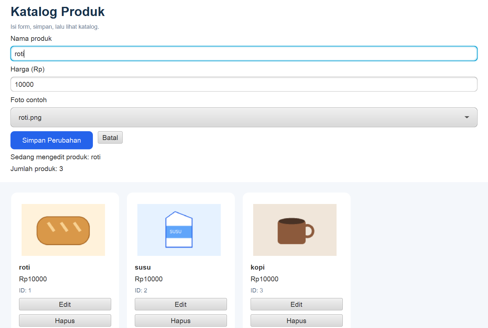
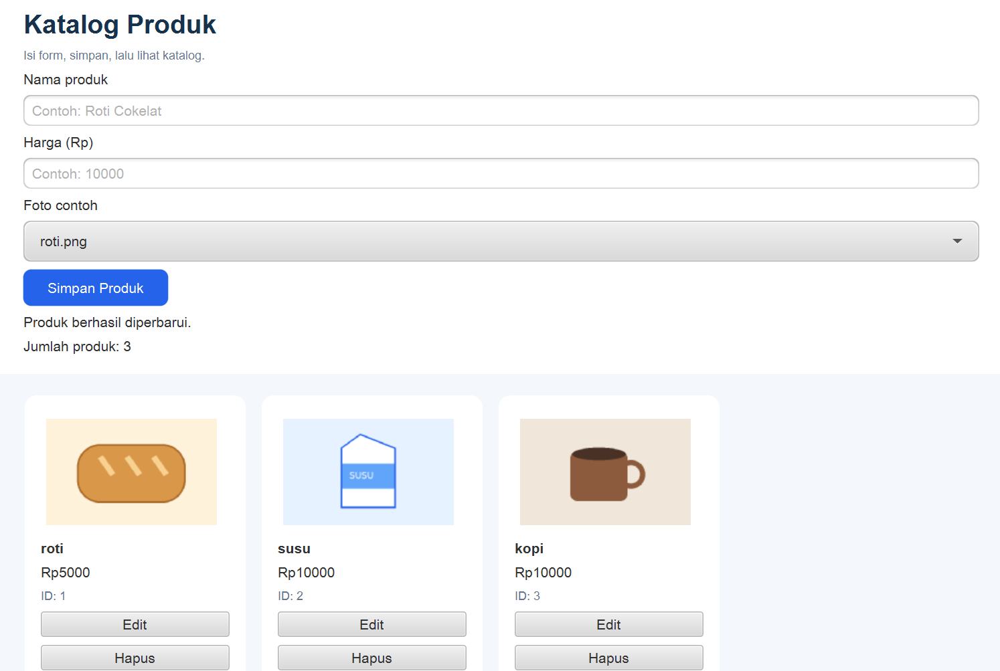
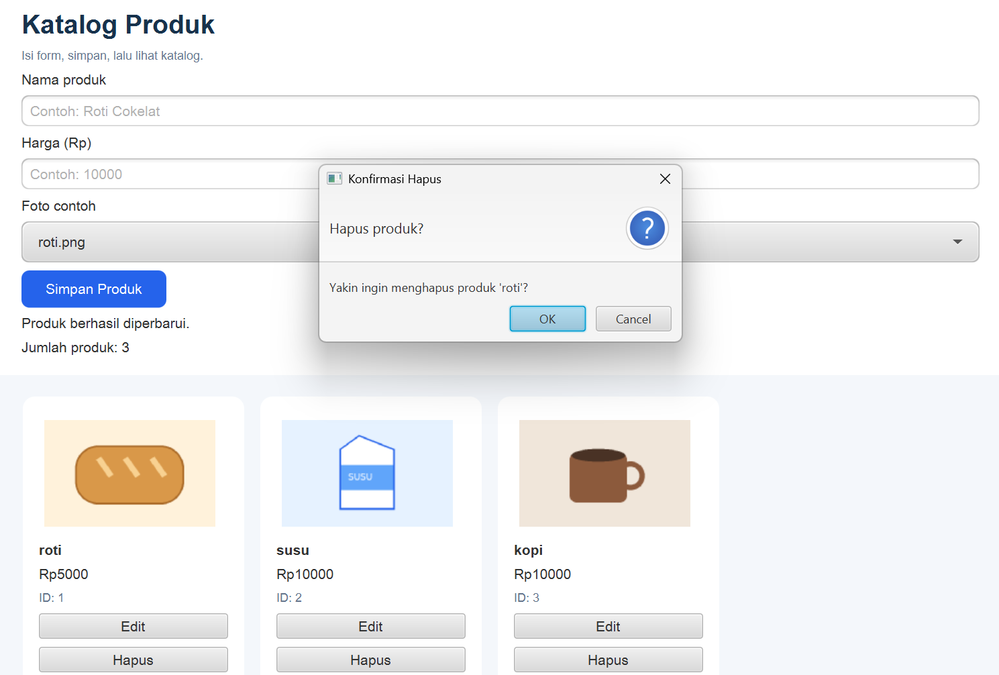
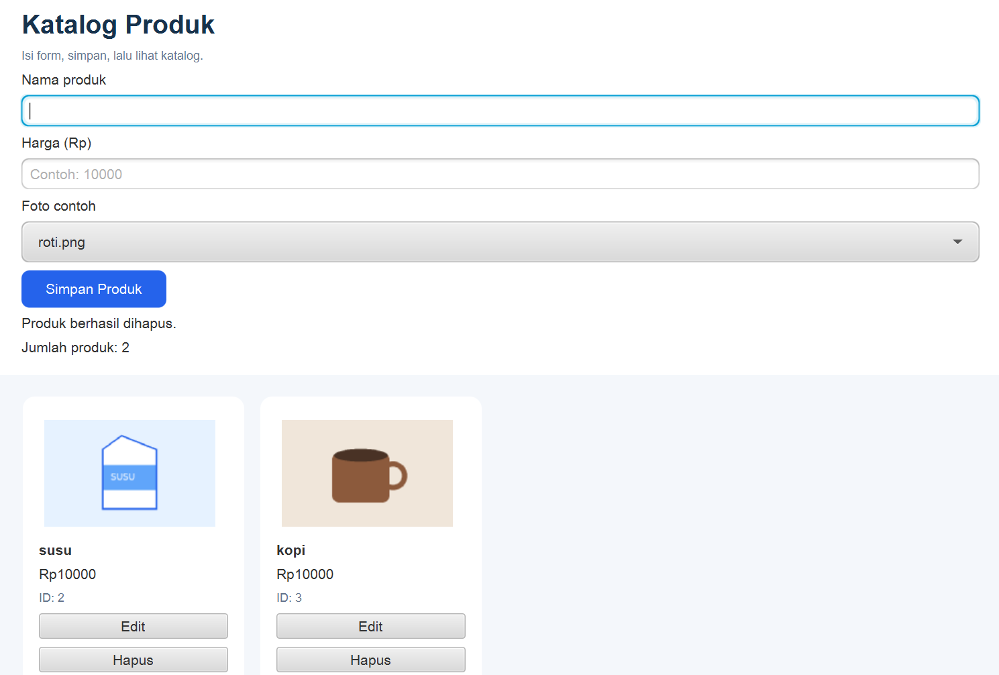

# Katalog Produk

Katalog Produk merupakan aplikasi desktop berbasis Java yang dikembangkan menggunakan JavaFX untuk mengelola data produk toko. Aplikasi ini memungkinkan pengguna melakukan pengelolaan data produk melalui fitur tambah, ubah, dan hapus.

Setiap produk ditampilkan dalam bentuk kartu katalog yang memuat foto, nama, harga, dan ID produk. Aplikasi ini juga menggunakan **SQLite** sebagai database lokal sehingga data produk yang telah disimpan tetap tersedia meskipun aplikasi ditutup dan dijalankan kembali.

## ✨ Fitur Aplikasi

- **Tambah Produk** – Menambahkan data produk baru melalui form yang tersedia.
- **Ubah Produk** – Memperbarui informasi produk yang telah tersimpan.
- **Hapus Produk** – Menghapus data produk dari katalog.
- **Foto Produk** – Memilih foto produk melalui pilihan gambar yang tersedia.
- **Katalog Produk** – Menampilkan produk dalam bentuk kartu yang berisi foto, nama, harga, dan ID.
- **Penyimpanan Data** – Menggunakan SQLite untuk menyimpan data produk secara permanen.
- **Jumlah Produk** – Menampilkan total produk yang tersimpan dalam database.

## 🚀 Instalasi dan Menjalankan Aplikasi

### 1. Clone Repository

Jalankan perintah berikut pada terminal:

```bash
git clone https://github.com/shabrinaputri2409-ops/Katalog-Produk.git
```

### 2. Masuk ke Folder Project

```bash
cd Katalog-Produk
```

### 3. Buka Project

Buka Apache NetBeans, kemudian pilih **File → Open Project** dan arahkan ke folder project yang telah di-clone.

### 4. Jalankan Aplikasi

Pada terminal yang berada di direktori utama project, jalankan:

```bash
mvn clean javafx:run
```

Setelah proses build berhasil, aplikasi Katalog Produk akan terbuka dan dapat digunakan.

## 📸 Dokumentasi Aplikasi

### 1. Form Input


### 2. Select Produk


### 3. Update Produk


### 4. Delete Produk


### 5. Results

